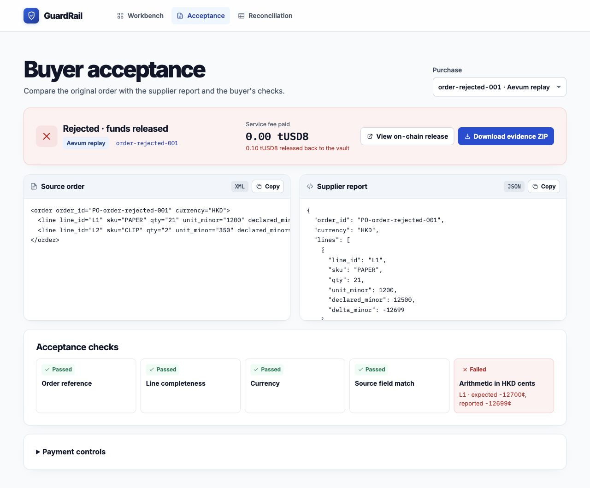
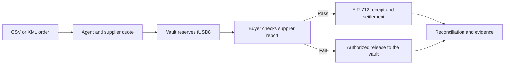

# GuardRail

GuardRail verifies supplier reports before settling procurement API fees. It uses synthetic HKD orders, deterministic buyer-side checks and a Solidity payment vault with EIP-712 acceptance receipts.

Run `npm ci` and `npm run workbench`, then open [the local workbench](http://127.0.0.1:3030/). Use Node 22 and Python 3 with `jsonschema`. The workbench includes read-only Aevum replay and an isolated Hardhat Sandbox for interactive purchases. See [Operations](OPERATIONS.md) for setup, evidence verification and deployment.

[Try the public wallet-free demo](https://guardrail-procurement-demo.autumnalchalk16.chatgpt.site/). Browser Sandbox orders use simulated payments and in-page session state. The Aevum replay includes the original signed evidence.

[Download the 3-minute English walkthrough](https://github.com/Betty227/GuardRail/releases/download/aevum-demo/guardrail-demo.mp4).

## Architecture and workflow

1. The workbench builds a synthetic CSV or XML purchase order. The purchase service selects an eligible supplier by format and price.
2. An authorized agent reserves the quoted fee in the vault under a stable purchase intent. Reusing the intent with the original quote resolves to the same payment ID.
3. The buyer-side verifier checks the supplier report against the source order. On acceptance it signs an EIP-712 receipt that binds the payment and the file hashes. On rejection an authorized sender can release the reservation.
4. The vault settles valid receipts to the quoted merchant. The reconciliation view links the decision and transaction evidence and exports records for review.

The local workbench runs this flow on Hardhat. The verified Aevum deployment demonstrates tUSD8 settlement and same-intent recovery. The public site replays those Aevum transactions and simulates new orders in the browser. Rebuild the static public demo with `python3 workbench/public-site/build.py <output-directory>`. Its separate hosting checkout is excluded from this repository.

## Payment controls

| Control | Effect on new reservations | Effect on existing reservations |
| --- | --- | --- |
| Pause via `setPaused(true)` | Blocks new reservations for both the owner and agent. | Blocks settlement. Authorized release remains available. |
| Revoke via `setPolicy` with the zero agent address | Removes the current agent's authority to reserve. The owner retains its authority. | A valid buyer receipt can still settle before the deadline while the vault is unpaused. |
| Release via `voidPayment` | A voided payment ID stays terminal. | The owner or verifier can release funds before expiry. After the deadline, anyone can submit the release. The vault makes the funds available again and restores the original Hong Kong budget day's capacity. |

The verifier signs acceptance receipts off-chain. If it submits an early release on Aevum, it pays transaction fees in tQDAY. The owner can also submit that transaction. See the [contract](contracts/GuardRailVault.sol), [verified Aevum deployment](https://explorer-test.qday.info/address/0xA38A8D54406d417EcFcd884BBA12E18079f74418?tab=contract) and [static analysis notes](audit/SLITHER.md).

Run `npm test` to check early release during a pause, agent revocation, aggregate spending limits and receipt integrity.

## License and dependencies

GuardRail's original source is available under the [MIT License](LICENSE). Direct dependencies used in the application or development workflow are OpenZeppelin Contracts, Hardhat, Hardhat Toolbox, ethers and Python jsonschema. Each uses the MIT license. Node dependencies and their resolved versions are listed in [package-lock.json](package-lock.json).
